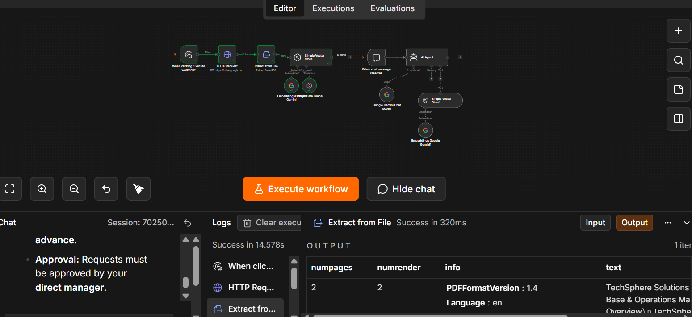
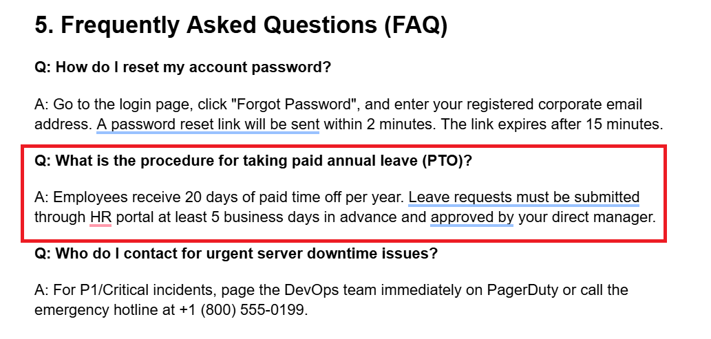

# 📚 RAG - Load Documents & AI Chat Agent

### 📌 Overview
This is an advanced Retrieval-Augmented Generation (RAG) workflow built with n8n. It operates in two main phases:
1. **Document Loading & Embedding Pipeline:** Downloads source PDFs from external links (such as Google Drive), extracts raw text, generates vector embeddings using **Google Gemini**, and indexes them into an **In-Memory Vector Store**.
2. **Interactive AI Chat Agent:** Receives user chat queries in real-time, queries the **In-Memory Vector Store** using semantic search tools, and provides precise, context-grounded answers powered by **Google Gemini**.

---

### 🎬 Workflow Preview

---

### 🛠️ Architecture & Node-by-Node Explanation

#### 1. 🔘 Manual Trigger (`n8n-nodes-base.manualTrigger`)
* **Purpose:** Manually triggers the document ingestion and embedding pipeline.
* **Key Settings:** `When clicking 'Execute workflow'`

#### 2. 🌐 HTTP Request (`n8n-nodes-base.httpRequest`)
* **Purpose:** Downloads the source document (PDF) from Google Drive or a direct URL.
* **Key Settings:**
  * `URL`: Direct file download link (e.g., Google Drive export link)
  * `Method`: `GET`

#### 3. 📄 Extract from File (`n8n-nodes-base.extractFromFile`)
* **Purpose:** Parses and extracts readable text from the downloaded binary file.
* **Key Settings:**
  * `Operation`: `pdf`

#### 4. 🧠 Embeddings Google Gemini (`@n8n/n8n-nodes-langchain.embeddingsGoogleGemini`)
* **Purpose:** Generates high-dimensional vector representations from the extracted document text.
* **Credentials:** Google Gemini / PaLM API

#### 5. 🗄️ Simple Vector Store - Insert Mode (`@n8n/n8n-nodes-langchain.vectorStoreInMemory`)
* **Purpose:** Indexes and stores vector embeddings into memory for document retrieval.
* **Key Settings:**
  * `Mode`: `insert`
  * `Memory Key`: `mydocs`
  * `Connected Components`: Default Data Loader & Gemini Embeddings

#### 6. 💬 Chat Trigger (`@n8n/n8n-nodes-langchain.chatTrigger`)
* **Purpose:** Receives user input and chat messages via the n8n Chat interface.

#### 7. 🤖 AI Agent (`@n8n/n8n-nodes-langchain.agent`)
* **Purpose:** Coordinates incoming queries, runs reasoning loops, and retrieves knowledge from the vector store to generate accurate responses.
* **Type Version:** `3.1`

#### 8. ⚡ Google Gemini Chat Model (`@n8n/n8n-nodes-langchain.lmChatGoogleGemini`)
* **Purpose:** The primary Large Language Model (LLM) responsible for understanding user intent and drafting responses.

#### 9. 🔍 Simple Vector Store - Retrieval Tool (`@n8n/n8n-nodes-langchain.vectorStoreInMemory`)
* **Purpose:** Acts as a search tool for the AI Agent to query relevant document chunks.
* **Key Settings:**
  * `Mode`: `retrieve-as-tool`
  * `Memory Key`: `mydocs`
  * `Tool Description`: *"Use this tool to search the user's uploaded documents for relevant information"*

#### 10. 🧠 Embeddings Google Gemini (Tool) (`@n8n/n8n-nodes-langchain.embeddingsGoogleGemini`)
* **Purpose:** Converts incoming user chat queries into embeddings to execute similarity searches against stored documents.

---

### 📝 System Prompts & Logic Setup

#### 1. AI Agent System Prompt:
> *"You are a helpful assistant. Answer questions using the provided document search tool. If the answer isn't found in the documents, say so honestly instead of making things up."*

#### 2. Vector Store Alignment:
* **Memory Key:** Both the insertion node and retrieval tool node utilize the key `mydocs` to ensure seamless read/write access across the workflow context.

---

### 📥 Step-by-Step Installation & Setup

1. **Repository Setup:**
   * Download the [`workflow.json`](./workflow.json) file.
   * Open your n8n dashboard -> Click **Import from File** and upload `workflow.json`.

2. **Credentials Configuration:**
   * **Google Gemini Credentials:** Attach your **Google Gemini (PaLM) API Key** to both `Embeddings Google Gemini` nodes and the `Google Gemini Chat Model` node.

3. **Document Ingestion:**
   * In the **HTTP Request** node, paste your target document's direct PDF download link.
   * Click **Execute Workflow** to run the ingestion pipeline and populate the vector store.

4. **Chat Execution:**
   * Open the n8n chat interface connected to the **When chat message received** trigger.
   * Submit queries related to your document to test RAG retrieval and accuracy.