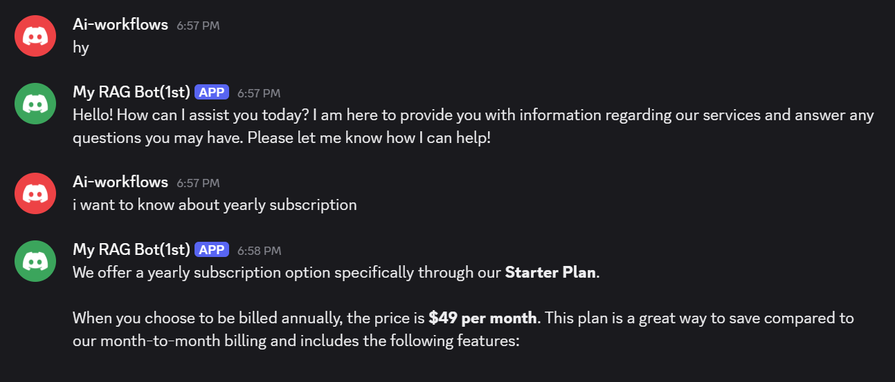
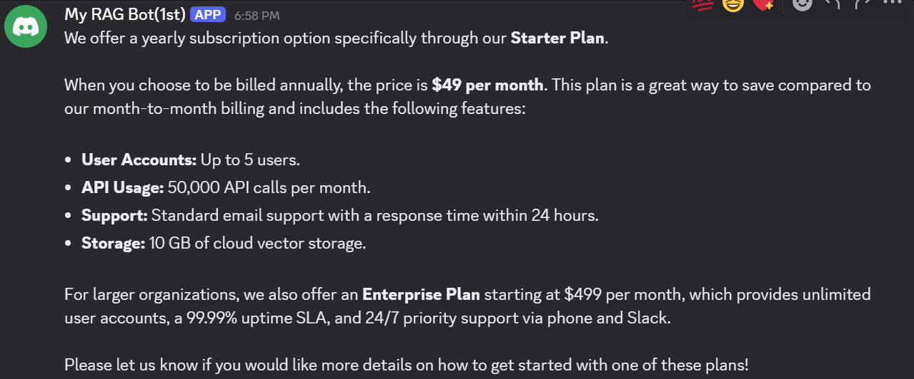

# 📚 RAG - Document Knowledge Base & Discord AI Assistant

### 📌 Overview
This is an advanced Retrieval-Augmented Generation (RAG) workflow built with n8n that turns custom PDF documentation into an automated Discord AI assistant. It operates in two main phases:
1. **Document Loading & Vector Ingestion Pipeline:** Downloads source PDFs from external storage (e.g., Google Drive), extracts raw text, generates high-dimensional embeddings using **Google Gemini**, and indexes them into an **In-Memory Vector Store**.
2. **Discord AI Assistant Agent:** Listens for incoming messages via a **Discord Trigger**, acts as an official company representative to query the **Vector Store** for answers, and posts context-grounded responses back to the specified Discord channel.

### 🎬 Workflow Preview

---

### 🛠️ Architecture & Node-by-Node Explanation

#### 1. 🔘 Manual Trigger (`n8n-nodes-base.manualTrigger`)
* **Purpose:** Manually initiates the document ingestion pipeline.
* **Key Settings:** `When clicking 'Execute workflow'`

#### 2. 🌐 HTTP Request (`n8n-nodes-base.httpRequest`)
* **Purpose:** Downloads the source PDF document from a Google Drive direct export URL or public file link.
* **Key Settings:**
  * `Method`: `GET`
  * `URL`: Direct PDF download link

#### 3. 📄 Extract from File (`n8n-nodes-base.extractFromFile`)
* **Purpose:** Extracts raw text content from the downloaded binary PDF file.
* **Key Settings:**
  * `Operation`: `pdf`

#### 4. 🧠 Embeddings Google Gemini (`@n8n/n8n-nodes-langchain.embeddingsGoogleGemini`)
* **Purpose:** Converts parsed document text chunks into vector embeddings.
* **Credentials:** Google Gemini (PaLM) API

#### 5. 🗄️ Simple Vector Store - Insert Mode (`@n8n/n8n-nodes-langchain.vectorStoreInMemory`)
* **Purpose:** Stores the generated document embeddings in memory for downstream similarity matching.
* **Key Settings:**
  * `Mode`: `insert`
  * `Memory Key`: `mydocs`

#### 6. 🎧 Discord Trigger (`n8n-nodes-discord-trigger.discordTrigger`)
* **Purpose:** Monitors connected Discord server channels in real-time and passes incoming user messages to the AI Agent.
* **Credentials:** Discord Bot Trigger account

#### 7. 🤖 AI Agent (`@n8n/n8n-nodes-langchain.agent`)
* **Purpose:** Runs reasoning loops, interprets user query intent, queries the Vector Store, and formulates responses in a professional company persona.
* **Input Text Mapping:** `={{ $json.content }}`
* **Type Version:** `3.1`

#### 8. ⚡ Google Gemini Chat Model (`@n8n/n8n-nodes-langchain.lmChatGoogleGemini`)
* **Purpose:** Primary LLM engine powering the AI Agent's language understanding and response generation.

#### 9. 🔍 Simple Vector Store - Retrieval Tool (`@n8n/n8n-nodes-langchain.vectorStoreInMemory`)
* **Purpose:** Functions as a custom tool for the AI Agent to query indexed document vectors.
* **Key Settings:**
  * `Mode`: `retrieve-as-tool`
  * `Memory Key`: `mydocs`
  * `Tool Description`: *"Use this tool to search the user's uploaded documents for relevant information"*

#### 10. 📤 Send a Message - Discord (`n8n-nodes-base.discord`)
* **Purpose:** Posts the AI Agent's final generated answer back to the configured Discord channel.
* **Message Content:** `={{ $json.output }}`
* **Credentials:** Discord Bot account

---

### 📝 System Prompts & Guardrails

#### AI Agent System Prompt:
> *"You are a helpful assistant of the company and you have to act as their assistant, reply from your pov, don't say 'the document says' instead represent yourself as a company employee. Answer questions using the provided document search tool. If the answer isn't found in the documents, say the answer is not related to our services please ask about our services in a professional manner."*

#### Key Persona Rules:
* **First-Person Representation:** Responds as a direct employee rather than referencing external files (`"We offer..."` instead of `"According to the document..."`).
* **Service Scope Enforcement:** Politely redirects out-of-scope queries back to company products and services.

---

### 📥 Step-by-Step Installation & Setup

1. **Import Workflow:**
   * Download the [`workflow.json`](./workflow.json) file.
   * Open your n8n dashboard, click **Import from File**, and upload `workflow.json`.

2. **Configure Credentials:**
   * **Google Gemini:** Connect your **Google Gemini API Key** to both `Embeddings Google Gemini` nodes and the `Google Gemini Chat Model` node.
   * **Discord Bot:** Attach your **Discord Bot Credentials** to both the `Discord Trigger` and `Send a message` nodes.

3. **Populate Knowledge Base:**
   * Paste your PDF download link into the **HTTP Request** node.
   * Click **Execute Workflow** once to run the document loader pipeline and index the embeddings into memory (`mydocs`).

4. **Set Up Discord Channel Routing:**
   * Select your target **Guild ID (Server)** and **Channel ID** in both the `Discord Trigger` and `Send a message` nodes.
   * Toggle the workflow status to **Active** to begin automated real-time support in Discord.