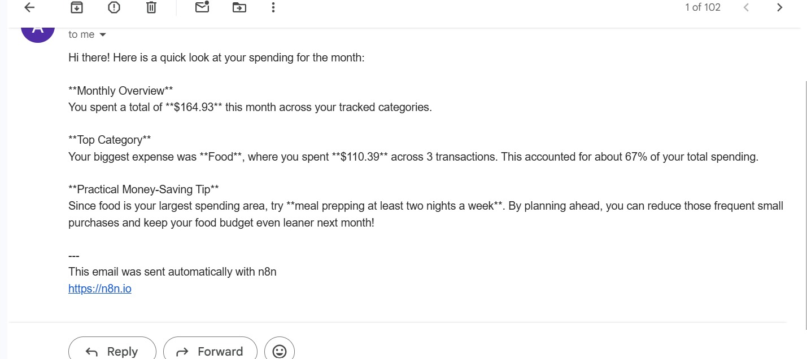
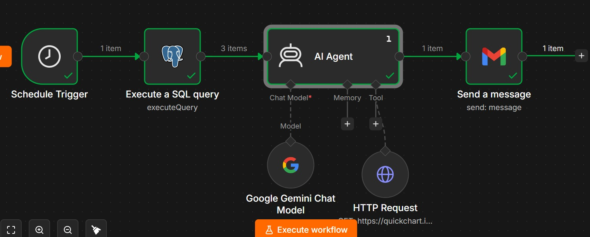
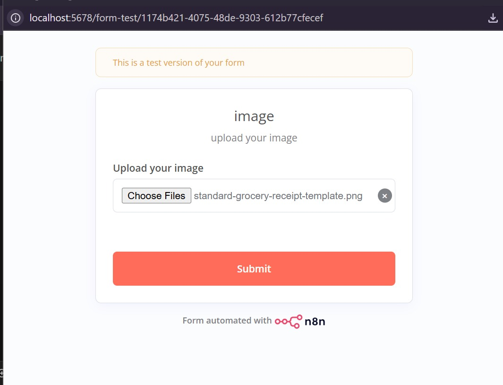

📚 Monthly Expense Report & AI Summary Workflow
📌 Overview
This is an automated financial reporting workflow built with n8n. It periodically aggregates expense data from a database, processes it using an AI Agent powered by Google Gemini, and emails a structured, friendly monthly financial summary directly to your inbox.

Automated Database Aggregation: A Schedule Trigger regularly queries a PostgreSQL database to group and summarize your expenses by category (SUM and COUNT).

AI-Powered Analysis & Summary: An AI Agent processes the spending dataset, leverages optional visual charts via an HTTP tool, and drafts a human-friendly expense breakdown with personalized money-saving tips.

Automated Email Delivery: The compiled report is sent automatically via Gmail to your registered email address.

🎬 Workflow Preview

🛠️ Architecture & Node-by-Node Explanation
1. ⏰ Schedule Trigger (n8n-nodes-base.scheduleTrigger)
Purpose: Automatically initiates the monthly financial aggregation process on a regular time schedule.

2. 🗄️ Execute a SQL Query (n8n-nodes-base.postgres)
Purpose: Runs a custom SQL query against your database to aggregate expenses by category.

Key Settings:

Operation: executeQuery

Query: SELECT category, SUM(amount) as total, COUNT(*) as count FROM expenses GROUP BY category ORDER BY total DESC;

Credentials: Postgres Account

3. 🤖 AI Agent (@n8n/n8n-nodes-langchain.agent)
Purpose: Coordinates the analysis of your spending data and drafts a friendly summary highlighting top spending categories and actionable insights.

Type Version: 3.1

4. ⚡ Google Gemini Chat Model (@n8n/n8n-nodes-langchain.lmChatGoogleGemini)
Purpose: The underlying Large Language Model (LLM) powering the AI Agent's reasoning and text generation.

Credentials: Google Gemini / PaLM API Account

5. 🌐 HTTP Request Tool (n8n-nodes-base.httpRequestTool)
Purpose: Acts as a tool for the AI Agent to generate dynamic visual charts via QuickChart APIs if needed.

Key Settings:

URL: [https://quickchart.io/chart?c=](https://quickchart.io/chart?c=){type:'pie',data:{labels:[...],datasets:[{data:[...]}]}}

6. 📧 Send a Message (n8n-nodes-base.gmail)
Purpose: Emails the final formatted text output generated by the AI agent to your destination email address.

Key Settings:

Send To: Target email address

Subject: Your Monthly Spending Report:

Message: ={{ $json.output }}

Credentials: Gmail OAuth2 Account

📝 System Prompts & Logic Setup
1. AI Agent Prompt Template:
Based on this spending data: {{ JSON.stringify($input.all().map(item => item.json)) }}
Write a friendly monthly spending summary. Highlight the top category, total spent, and one practical money-saving tip based on the pattern.

📥 Step-by-Step Installation & Setup
Repository Setup:

Download the workflow.json file.

Open your n8n dashboard -> Click Import from File and upload workflow.json.

Credentials Configuration:

PostgreSQL Credentials: Connect your database account to the Execute a SQL query node.

Google Gemini Credentials: Attach your Google Gemini API Key to the Google Gemini Chat Model node.

Gmail Credentials: Connect your Gmail OAuth2 account to the Send a message node.

Workflow Execution & Testing:

Click Execute Workflow manually to test the database read, AI summary generation, and email delivery.

Turn the workflow Active to let the schedule trigger run it automatically.